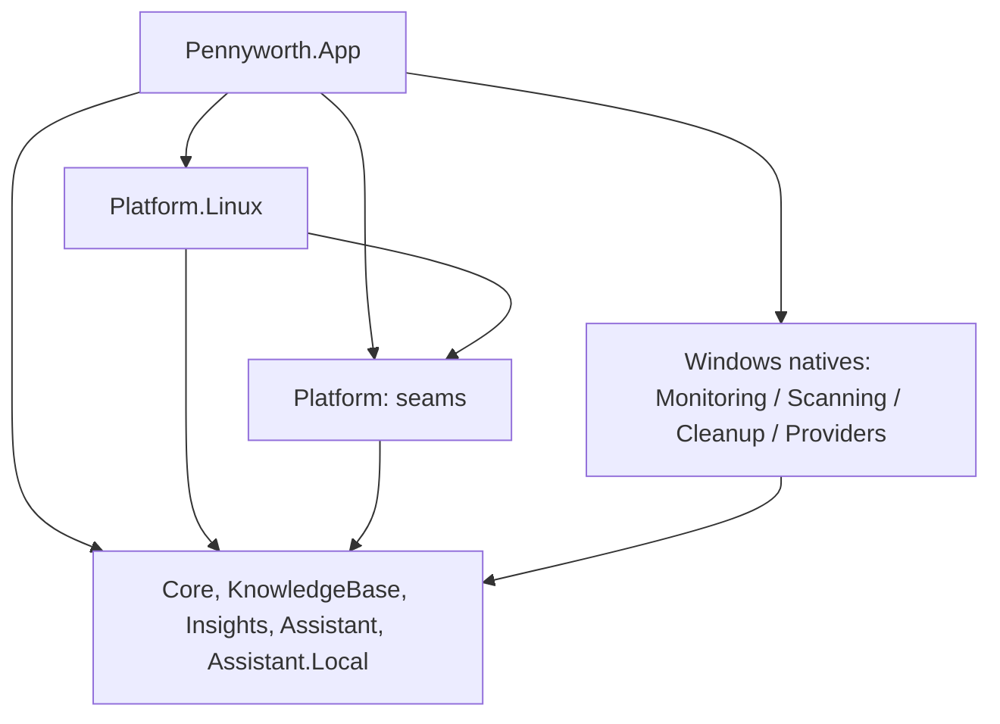

# Linux port: findings and implementation plan

**Date:** 2026-10-26, revised after the first Windows fixes merged
**Status:** plan, not implemented; §6 is the part that answers "how does the local model run"
**Scope:** make Pennyworth run natively on Linux (X11/Wayland, x64/arm64) with the same screens,
the same guarantees and the same data as the Windows build — without putting platform code into
the Windows code paths.

---

## 1. Verdict and evidence

The solution **builds and the Avalonia UI renders on Linux today**, but the app **cannot run**:
the data-producing subsystems are direct P/Invoke into `kernel32`, `advapi32`, `pdh`, `ntdll`,
`shell32` and `user32`, and there is **not one platform guard in `src/`** (`grep` for
`OperatingSystem.Is*`, `RuntimeInformation.IsOSPlatform`, `#if WINDOWS` → 0 hits).

Measured on this machine (openSUSE Tumbleweed, .NET SDK 10.0.403) against `main` at `4f44cca`,
**after** four of the five review fixes were merged (#6, #7, #9, #10 — the Anonymizer fix, PR #8,
is still open):

| Measurement | Result |
|---|---|
| `dotnet build Pennyworth.slnx` | success, 0 warnings, 0 errors, 20 projects |
| `dotnet test Pennyworth.slnx` | **358 total — 323 pass, 34 fail, 1 skipped** |
| `dotnet publish -r linux-x64 --self-contained` | "succeeds" but ships `DirectML.dll`; no Linux natives |
| run `Pennyworth.dll` | `DllNotFoundException: 'pdh.dll'` at `SystemMonitor..ctor` (`App.axaml.cs:27`) |
| run with `SystemMonitor` stubbed (temporary patch, reverted) | **full UI renders**: X11 backend, bundled fonts, PT-BR strings, ASCII panel |

The last row matters: **the UI layer is already portable**. Only the services underneath are not.

Failures by cause:

| Cause | Count | Meaning |
|---|---|---|
| Missing native library (`kernel32`/`advapi32`/`pdh`) | 9 | Windows-only fact — declare and skip |
| Spawns `cmd.exe` (junction/sparse fixtures) | 3 | Test fixture |
| Windows ACL APIs | 1 | Test fixture |
| Windows path-semantics assumption | 21 | Fixtures only — every defect that used to hide here is now closed (§3) |

Per project: Cleanup 10, App 9, Scanning 8, Monitoring 3, Core 2, Assistant 1, Providers 1;
KnowledgeBase, Insights and Assistant.Local pass fully.

## 2. What is coupled to Windows

**24 code files plus 5 bilingual data files** are tied to Windows. Only some of them are P/Invoke;
the rest encode Windows assumptions and would produce wrong results while crashing nothing.

**Native calls — 2,072 lines of Windows-only C# across 18 files** (of 23,191 lines of C# and XAML
in `src/`; the 17 below plus `SystemMonitor`, which exists only to drive them):

| Location | Windows dependency | Consumed by |
|---|---|---|
| `Scanning/Native/NativeMethods.cs`, `NativeDirectory.cs` | `FindFirstFileExW`, `FindNextFileW`, `GetCompressedFileSizeW`, `GetDiskFreeSpaceW` | every scan |
| `Scanning/DirectoryScanner.cs` | drives the native listing; the tree/progress/category pipeline around it is portable | every scan |
| `Scanning/HiddenSpace.cs` | `CreateFileW` + `FSCTL_GET_NTFS_VOLUME_DATA`, PowerShell CIM; also home to `RunCaptured`, the bounded-process helper the Linux side should reuse | "Unlock full scan" |
| `Monitoring/Native/MonitorNative.cs` | `NtQuerySystemInformation`, `GlobalMemoryStatusEx`, `K32GetPerformanceInfo`, `GetSystemTimes`, `OpenProcess`, `QueryFullProcessImageNameW` | startup |
| `Monitoring/Native/ProcessReader.cs` | hardcoded x64 `SYSTEM_PROCESS_INFORMATION` offsets | startup |
| `Monitoring/Native/Pdh.cs`, `GpuMeter.cs` | PDH counters (`\GPU Engine(*)\Utilization Percentage`) | startup, live screen |
| `Monitoring/Native/ServiceReader.cs` | `advapi32` SCM enumeration | app grouping |
| `Monitoring/Hardware/HardwareNative.cs` | `GetSystemFirmwareTable`, `GetLogicalProcessorInformation`, `\\.\PhysicalDriveN` IOCTLs, `EnumDisplayDevicesW`, `EnumDisplaySettingsW`, `GetSystemPowerStatus` | Specs |
| `Monitoring/Hardware/WindowsSpecsReader.cs` | `Microsoft.Win32.Registry` | Specs |
| `Cleanup/RecycleBin.cs` | `shell32!SHUpdateRecycleBinIcon`, SID dirs, `$I`/`$R` records | Cleanup |
| `Assistant.Providers/WindowsCredentialStore.cs` | `advapi32` CredRead/Write/Delete | Ask |
| `Assistant.Local` (package) | `Microsoft.ML.OnnxRuntimeGenAI.DirectML` — assets exist **only** for `win-x64`/`win-arm64`. The llama.cpp switch (§6) removes this per-OS native coupling entirely | local model |
| `App/Services/HiddenSpaceService.cs` | `Verb = "runas"` (UAC) | "Unlock full scan" |
| `App/Services/ExplorerLauncher.cs` | `explorer.exe /select,` | "Show in Explorer" |
| `App/Services/DriveService.cs` | `DriveInfo` semantics, `Environment.SystemDirectory` | drive list |
| `App/Services/AssistantServices.cs` | `WindowsCredentialStore`, `DriveInfo.AvailableFreeSpace` | Ask |

**Windows semantics without P/Invoke** (must be split too, or the UI lies):

| Location | Assumption |
|---|---|
| `Scanning/SizeOnDisk.cs` (43 lines) | `FILE_ATTRIBUTE_RECALL_ON_DATA_ACCESS`, cloud reparse tags, `SparseFile`/`Compressed` flags, cluster rounding — none of these are reported on Linux, so every size would be logical, not allocated |
| `Insights/Classification/RuleClassifier.cs`, `PathPattern.cs` | `%VAR%` expansion from Windows variables; drive-letter `?:` wildcard; no notion of a Unix root, so patterns are matched by tail only (§3) |
| `Assistant/Facts/FactCollector.cs` | `os.name` is the literal `"Windows"` (line 37), "Windows is installed on" (64), "Windows drive is a hard disk" (65), `StorageCategory.Windows => "Windows"` (232) |
| `App/Views/MainWindow.axaml` | `ExtendClientAreaToDecorationsHint="True"` — custom title bar over the Windows client area; behaviour on X11/Wayland must be verified, it is expected to be ignored and produce double chrome |
| `App/Resources/Strings.resx` + `Strings.pt-BR.resx` | 25 + 19 entries that say Windows, Explorer or Recycle Bin ("Show in Explorer", "Opening in Windows Explorer", "Windows keeps this folder locked", "Windows rebuilds them", category titles) |
| `KnowledgeBase/Data/*.json` | `%LOCALAPPDATA%`, `%SystemRoot%`, `%TEMP%`, `%USERPROFILE%`, `%SystemDrive%`, `%ProgramData%`, Windows process names, Windows diagnosis rules |

## 3. Defects: what the merges closed, what is left

Four of the five defects found in review are merged into `main` (#6, #7, #9, #10); the Anonymizer
fix (#3, PR #8) is still open, so the port must not assume it. This is the state the plan starts
from.

### Closed on `main`

| # | Defect | What the port inherits |
|---|---|---|
| 1 | `CleanupTargets.Match` rebuilt the walk from the first segment, so any path without a drive letter (UNC, POSIX) resolved to nothing | Walks from `Path.GetPathRoot`; `CleanupTargets` needs no port work |
| 2 | `SafetyGuard` failed open when a protection variable was missing | Deny-by-default, `ProgramFiles` required, `Program Files (x86)` derived from the Windows path, comparisons accept both separators. Still a Windows guard — Linux needs its own |
| 4 | The shell swallowed a failed scan and could die on a failed sample | A failed scan shows a toast and keeps the previous summary; a failed sample cannot escape the tick. Linux scan failures inherit both |
| 5 | `--measure-hidden` read stdout before waiting, so the 30 s bound never applied | `HiddenSpace.RunCaptured(file, args, timeout)` — **reuse it for the `btrfs`/`snapper` probes** instead of writing a second bounded-process runner |

### Still open

1. **`Anonymizer` is backslash-shaped** — fixed in PR #8, not yet merged. Until it lands, a POSIX
   profile does not match the pattern and personal folder names leak; after it lands,
   `Anonymizer.ForCurrentUser()` works unchanged. `CommonFolders` remains a Windows list, which
   fails safe (unknown folders are hidden), so adding the XDG names is polish, not a blocker.
2. **`WindowsDriveService`** — `DriveInfo.GetDrives()` returns 40 mounts here, including 7 btrfs
   subvolume mounts of one device, `tmpfs`/`/proc`/`/sys` pseudo-filesystems, and
   `/sys/firmware/efi/efivars` typed `Fixed` (the `/sys/firmw` on the welcome screen).
   `VolumeLabel` is the mount path; `SystemDriveRoot` becomes `"C:\"` because
   `Environment.SystemDirectory` is empty and `Path.GetPathRoot("")` is `null`.
3. **`ProcessCloser.CloseAsync`** (`ProcessCloser.cs:29`) calls `CloseMainWindow()`, which is a
   no-op returning `false` on Unix. Graceful close must send `SIGTERM` first.
4. **`FactCollector` hardcodes the OS as Windows**: `os.name` is the literal `"Windows"` (line 37),
   "Windows is installed on" (64), "Windows drive is a hard disk" (65),
   `StorageCategory.Windows => "Windows"` (232). On Linux the assistant would assert a false fact
   about the machine it is describing.
5. **`PathPattern` has no Unix root.** `SplitPath` drops the leading `/` and `IsMatch` compares only
   the last N segments, so `/var/cache` also matches `/home/x/var/cache`, and `?:` can never match.
   Linux knowledge-base patterns cannot be written safely until this is fixed.
6. **`SizeOnDisk` encodes Windows semantics**: cloud reparse tags, `SparseFile`/`Compressed`
   attributes and cluster rounding. Linux reports none of those attributes, so allocated size must
   come from `st_blocks` and the helper is replaced rather than reused.
7. **`IsPseudoAdapter`** filters Windows driver descriptions ("Miniport", "Loopback", "Filter",
   "Scheduler"). On Linux `docker0`, `veth*`, `virbr0`, `tun*`, `wg*` and `lo` reach the Specs
   screen.
8. **Case-insensitive path handling** (`StringComparer.OrdinalIgnoreCase` in `CleanupTargets`,
   `CleanupService.DeleteFileIn` and `RemoveEmptiedFolders`) is wrong on case-sensitive
   filesystems: it can dedupe two distinct folders into one and mis-scope a root check. The guard's
   own comparisons were fixed in #7; these three were not.
9. **Wording**: `ContextBuilder` says "Item in the Recycle Bin", `PersonaPrompt` advises "emptying
   the Recycle Bin", `advice.json` says "leave Windows unstable", and 44 resx entries name Explorer,
   the Recycle Bin or Windows.
10. **`StorageCategory.Windows`** is a category *name* used as data: the enum member, the KB JSON
    `"category": "Windows"`, the resx titles and the fact labels.

---

## 4. Detachment architecture

### 4.1 Principles

1. **No `#if WINDOWS` and no OS checks in domain code.** OS selection happens in exactly two
   places: the composition root and the `Pennyworth.Platform.*` assemblies.
2. **Linux code lives only in `src/Pennyworth.Platform.Linux`.** It never references a Win32
   symbol, never edits `src/Pennyworth.Monitoring/Native/`, and is referenced only by
   `Pennyworth.App` and its own test project.
3. **Windows code is not rewritten.** It stays where it is and keeps its behaviour; the only edit
   is `[SupportedOSPlatform("windows")]` plus seam parameters with Windows-preserving defaults.
   Moving it into `Pennyworth.Platform.Windows` is a later, mechanical step (Phase 9).
4. **Single target framework** (`net10.0`), single solution. Platform choice is runtime
   (`OperatingSystem.IsWindows()`), packaging choice is RID.
5. **Every shared edit is behaviour-preserving on Windows**, and the Windows suite stays green
   after each phase.

### 4.2 Why not the alternatives

| Option | Why rejected |
|---|---|
| `#if WINDOWS` through domain projects | scatters platform knowledge across 120 files; every Linux change becomes a merge risk |
| Multi-target `net10.0-windows;net10.0` | doubles build time, forces `#if`, NuGet assets still need per-RID selection |
| `Platform.Linux` referencing `App` | impossible — `App` is outermost; would invert the dependency |
| Do nothing | not what was asked |

### 4.3 Target tree

```
Directory.Build.props                 TargetFramework net10.0 (was net10.0-windows)
src/
  Pennyworth.Core/                    unchanged              (StorageCategory naming, Phase 6)
  Pennyworth.KnowledgeBase/           + linux data set       (platform-aware loader, Phase 6)
  Pennyworth.Insights/                PathPattern root fix   (shared logic, Phase 6)
  Pennyworth.Scanning/                Windows natives stay, annotated
  Pennyworth.Cleanup/                 + CleanupEnvironment seam
  Pennyworth.Monitoring/              Windows natives stay, annotated
  Pennyworth.Assistant/               OS facts from PcSpecs  (Phase 6)
  Pennyworth.Assistant.Providers/     WindowsCredentialStore annotated
  Pennyworth.Assistant.Local/         backend packages per artifact (§6.3)
  Pennyworth.App/                     composition root picks IPlatform
  Pennyworth.Platform/         NEW    seams only, no implementation, no Avalonia
  Pennyworth.Platform.Linux/   NEW    every Linux implementation + Linux data
tests/
  Pennyworth.Platform.Linux.Tests/ NEW
  ...existing   (Windows-only facts gain Assert.SkipUnless + [SupportedOSPlatform])
Pennyworth.slnx                       additive entries only
```



`Pennyworth.Platform` references only the projects that own the seams it forward-declares: `Core`
(`IStorageScanner`, `IPathClassifier`, `StorageCategory`), `Cleanup` (`CleanupRule`,
`ICleanupService`, `CleanupFile`), `Monitoring` (`ISystemMonitor`, `IProcessCloser`,
`ISpecsReader`, `ProcessExplanation`), `Assistant`/`Providers`/`Local` (`AssistantServices`,
`ICredentialStore`, `ModelCatalog`, `LocalModelStore`). No implementation, no Avalonia.

### 4.4 `IPlatform` — the only OS-aware type in the app

```csharp
public interface IPlatform
{
    string Name { get; }                          // "windows" | "linux"
    string OsName { get; }                        // "Windows 11" | "Linux (openSUSE Tumbleweed)"
    LocalModelBackend ModelBackend { get; }       // DirectMl | Cuda | Cpu — decides which model is offered
    StringComparer PathComparer { get; }          // OrdinalIgnoreCase | Ordinal

    // Data and configuration locations.
    string SettingsPath { get; }
    string ConversationFolder { get; }
    string UsagePath { get; }
    string CleanupHistoryPath { get; }
    string ModelRoot { get; }

    // System services.
    IDriveService Drives { get; }
    IStorageScanner Scanner { get; }
    IExplorerLauncher Explorer { get; }
    IHiddenSpaceService HiddenSpace { get; }
    IProcessCloser Closer { get; }
    ISpecsReader Specs { get; }

    // Windows variable names (%TEMP%, %LOCALAPPDATA%, ...) resolved for this OS.
    string? ResolveVariable(string name);

    // Replaces SafetyGuard: may a cleanup rule delete inside this folder?
    bool MayCleanInside(string folder);

    // OS-specific wording: "Explorer" vs "Files", "Recycle Bin" vs "Trash", Windows vs system.
    string Text(PlatformText text, bool portuguese);

    // Built from data owned by App, and after the monitor exists.
    ICleanupService CreateCleanup(IReadOnlyList<CleanupRule> rules);
    ISystemMonitor? CreateMonitor(IEnumerable<ProcessExplanation> explanations);
    AssistantServices CreateAssistant(Func<long> availableMemory);
}
```

`App.axaml.cs` becomes:

```csharp
IPlatform platform = OperatingSystem.IsWindows() ? new WindowsPlatform() : new LinuxPlatform();
IPathClassifier classifier = new RuleClassifier(
    KnowledgeBaseLoader.LoadEmbedded(platform.Name).Locations, platform.ResolveVariable);
ISystemMonitor? monitor = platform.CreateMonitor(KnowledgeBaseLoader.LoadProcesses(platform.Name).Processes);
var viewModel = new MainWindowViewModel(new AppServices(
    platform.Drives, platform.Scanner, classifier,
    new KnowledgeBaseLocationInfo(classifier), platform.Explorer,
    platform.CreateCleanup(KnowledgeBaseLoader.LoadCleanupRules(platform.Name).Rules),
    platform.HiddenSpace, new FileSettingsStore(platform.SettingsPath),
    monitor, platform.Closer, new CleanupHistory(platform.CleanupHistoryPath),
    Specs: platform.Specs,
    Clipboard: new AvaloniaClipboardService(() => desktop.MainWindow),
    Assistant: platform.CreateAssistant(() => monitor?.Sample().Memory.Available ?? 0)));

desktop.Exit += (_, _) => (monitor as IDisposable)?.Dispose();
```

The last three arguments stay named, as they are today — `AppServices` has optional parameters in
between. `CreateMonitor` may return `null`, so disposal goes through `IDisposable`.

`WindowsPlatform` stays **inside `Pennyworth.App/Services/Windows/`** until Phase 9, wrapping the
current classes with no behaviour change.

`AppServices` (`MainWindowViewModel.cs:18`) keeps its shape; it stays in `App` because it carries
`IClipboardService` (Avalonia types).

### 4.5 What moves out of `App` into `Pennyworth.Platform`

Four abstraction files, zero behaviour:

| From | To | Content |
|---|---|---|
| `App/Services/DriveService.cs` | `Platform/Seams/IDriveService.cs` | `IDriveService`, `DriveSummary` |
| `App/Services/ExplorerLauncher.cs` | `Platform/Seams/IExplorerLauncher.cs` | `IExplorerLauncher` |
| `App/Services/HiddenSpaceService.cs` | `Platform/Seams/IHiddenSpaceService.cs` | `IHiddenSpaceService`, `UnlockOutcome`, `UnlockResult` |
| `App/Services/AssistantServices.cs` | `Platform/Seams/AssistantServices.cs` | `AssistantServices` record (not `CreateDefault`) |

Implementations stay in `App/Services/Windows/`. Eight hand-written files gain
`using Pennyworth.Platform;`: `App.axaml.cs`, `MainWindowViewModel.cs`, `AskViewModel.cs`,
`CleanupViewModel.cs`, `CleanupPreviewViewModel.cs`, `tests/.../Fakes.cs`,
`tests/.../AskViewModelTests.cs`, `tests/.../AssistantPrivacyTests.cs`.

### 4.6 Cleanup seam

`CleanupService` must stop calling the Windows static directly. One optional parameter, Windows
defaults preserved so every existing call site and test compiles unchanged:

```csharp
public sealed record CleanupEnvironment(
    Func<string, string?> Variables,      // %TEMP% → this OS's temp
    IRecycleBin RecycleBin,
    Func<string, bool> MayCleanInside,    // replaces the internal SafetyGuard
    StringComparer PathComparison);

public sealed class CleanupService(
    IReadOnlyList<CleanupRule> rules,
    Func<string, string?>? getEnvironmentVariable = null,
    CleanupEnvironment? environment = null) : ICleanupService;

public interface IRecycleBin
{
    IReadOnlyList<CleanupFile> List();
    bool Delete(CleanupFile item);
    void RefreshIcon();
}
```

`environment == null` ⇒ `WindowsCleanupEnvironment` (existing `RecycleBin`, `SafetyGuard.…`,
`OrdinalIgnoreCase`). The path-resolution and safety defects are already fixed in `main`; what this
seam still carries is the platform path comparer (§3 item 8), so a Linux caller can pass
`StringComparer.Ordinal` without a second code path.

### 4.7 Anti-drift guardrails (CI gates)

1. `grep -rn 'LibraryImport\|DllImport' src/Pennyworth.Platform.Linux` may only match `libc` /
   `libsecret`. Any `.dll` → fail.
2. `grep -rn 'OperatingSystem\.Is' src` may only match `App.axaml.cs` and the
   `Platform.*` projects.
3. `Platform.Linux` and `Platform.Windows` never reference each other.
4. `TreatWarningsAsErrors` and `CA1416` stay on — `CA1416` is what proves neutral code cannot
   reach Windows code.

---

## 5. Build system changes

### 5.1 Target framework and annotations

`Directory.Build.props:3` → `net10.0`. Consequences to expect on first build: `Microsoft.Win32.Registry`
and every Win32 call raise `CA1416` (registry types exist in the shared framework and throw
`PlatformNotSupportedException` on Unix, but the analyzer flags the call).

Annotate the **18 Windows-only implementation types**:

```
Scanning:            NativeMethods, NativeDirectory, HiddenSpace, DirectoryScanner
Monitoring:          MonitorNative, Pdh, MemoryCounters, GpuMeter, ProcessReader, ServiceReader,
                     HardwareNative, WindowsSpecsReader, SystemMonitor
Cleanup:             RecycleBin
Assistant.Providers: WindowsCredentialStore
App:                 WindowsDriveService, ExplorerLauncher, ElevatedHiddenSpaceService
```

Neutral and **unannotated** (Linux reuses them): `CpuTracker`, `AppGrouper`, `IProcessDetails`,
`AppGroup`, `ProcessSample`, `MemoryStatus`, `MonitorSample`, `ISystemMonitor`, `IProcessCloser`,
`ISpecsReader`, `PcSpecs` and its records, `Smbios`, `SizeOnDisk` (logic is replaced, not
annotated), `CleanupService`, `CleanupTargets`, all of `Assistant`.

`SystemMonitor` aggregates native calls, so the whole class is Windows-only; Linux gets its own
`ISystemMonitor`, reusing `CpuTracker` and `AppGrouper` (both public).

### 5.2 Project conventions for the new assemblies

Repo rules inherited from `Directory.Build.props` (TFM, nullable, warnings-as-errors). Per project:

- `IsAotCompatible=true` (matches every existing project).
- `AllowUnsafeBlocks=true` on `Platform.Linux` (`statx`, libsecret).
- `InternalsVisibleTo` for the matching test project (matches every existing project).
- New NuGet packages **must** be added to `Directory.Packages.props` — central package management
  is on, so an undeclared `PackageReference` fails restore.
- `Platform.Linux` embeds its own data files with logical names, following
  `Pennyworth.KnowledgeBase`'s `LogicalName="…"` convention.

### 5.3 App project

```xml
<PropertyGroup>
  <OutputType Condition="'$(OS)' != 'Unix'">WinExe</OutputType>
  <ApplicationManifest Condition="'$(OS)' != 'Unix'">app.manifest</ApplicationManifest>
  <ApplicationIcon Condition="'$(OS)' != 'Unix'">Assets\pennyworth.ico</ApplicationIcon>
</PropertyGroup>
```

The icon and manifest are Windows packaging artefacts; `WinExe` on Unix only changes the apphost
subsystem flag, but `Exe` is honest.

### 5.4 Local inference build inputs

The runtime, backend selection, model catalogue and packaging have their own section: **§6**.
The only build-system fact that belongs here is that exactly one backend package is referenced per
artifact and pinned centrally, so each artifact gets the natives it ships with.

### 5.5 Packaging

| Artefact | Windows (today) | Linux (new) |
|---|---|---|
| Publish | `-r win-x64 -p:PublishAot=true` | `-r linux-x64 -p:PublishAot=true` |
| Launcher | `.exe` | apphost + `share/applications/pennyworth.desktop` (`StartupWMClass`, `MimeType`) |
| Icon | `.ico` | `share/icons/hicolor/{16…256}/apps/pennyworth.png` |
| Elevation | `runas` / UAC | **none** — D1 replaces the elevated NTFS measurement with an unprivileged system-space bucket |
| Data | `%LocalAppData%\Pennyworth` | `$XDG_DATA_HOME/Pennyworth` (conversations, models, history) |
| Settings | same | `$XDG_CONFIG_HOME/Pennyworth/settings.json` (D2) |

Natives the Linux publish must contain, or the related feature must disable itself at startup:
`libonnxruntime-genai.so`, `libsecret-1.so.0` (if the P/Invoke route wins), `libX11`,
`libfontconfig` (Avalonia handles the last two).

---

## 6. Local AI inference on Linux

**Decided after a spike on this machine: llama.cpp through LLamaSharp, for both operating systems.**
The earlier plan used ONNX Runtime Gen AI, which cannot reach a Vulkan GPU — ONNX Runtime has no
Vulkan execution provider, and Gen AI's build script accepts only CUDA, DirectML and WinML. That
left AMD and Intel cards running on the CPU. llama.cpp ships Vulkan, CUDA and CPU on both platforms
at a third of the bytes.

### 6.1 What carries over unchanged

- The assistant contract: `IChatClient`, streaming pieces, usage counts, the 5-minute idle unload.
- Facts, diagnosis, persona, action links, advice filter — the model still only explains.
- The download model: pinned revision, per-file SHA-256, resumable transfer, `.verified` marker.
- The Ask screen and the rule that nothing runs, downloads or connects until the person asks.

### 6.2 What changes in code

`LocalChatClient` is written against ONNX Runtime Gen AI today (`Model`, `Tokenizer`, `Generator`,
`OgaHandle`, `config.AppendProvider("dml")`). It becomes an LLamaSharp client:

| Today | With LLamaSharp |
|---|---|
| `new Config(folder)` + `AppendProvider("dml")` | `LLamaWeights.LoadFromFile(ModelParams)`; the backend comes from which native package is deployed |
| `Tokenizer.ApplyChatTemplate` | the chat template stored in the GGUF, applied by `ChatSession` |
| `Generator` loop + manual stop-string holdback | `ChatSession.ChatAsync(message, InferenceParams)` yields `IAsyncEnumerable<string>` |
| `do_sample = false`, `repetition_penalty` | a greedy sampling pipeline (`Temperature = 0`) and the pipeline's repeat penalty |
| stop strings from the catalogue | `InferenceParams.AntiPrompts` plus the model's own EOS |
| usage from `Generator` token counts | prompt/decoded counts from the context |

LLamaSharp 0.30's API is not what its README shows — learned while spiking: `WithLibrary(name,
mtmdPath)`, `ChatAsync` returns a stream rather than a string, and a turn is a `ChatHistory.Message`.
The streaming shape fits: `GetStreamingResponseAsync` already streams.

**Opportunity, not a requirement:** llama.cpp supports GBNF grammars, so the trailing action code
(the model must emit exactly one `nav:…` token today, enforced by prose) could be *constrained*
instead of requested. Worth trying once the client is ported; the `ActionLinker` contract stays.

### 6.3 Backends, packages and sizes (measured from NuGet)

| Package | Size | Platforms |
|---|---|---|
| `LLamaSharp` (managed) | 0.4 MB | — |
| `LLamaSharp.Backend.Cpu` | 40.4 MB | Windows, Linux, macOS; `avx512`/`avx2`/`avx`/`noavx` + `arm64` |
| `LLamaSharp.Backend.Vulkan.Linux` / `.Windows` | 17.5 MB | Linux, Windows |
| `LLamaSharp.Backend.Cuda12.Linux` / `.Windows` | 229.6 MB | Linux, Windows |

One backend package per artifact; LLamaSharp picks the right native folder and, when the Vulkan
package is present, prefers it (`PreferVulkan: True` in the spike log). Simpler than the ONNX plan,
where the provider name had to be hardcoded per platform.

### 6.4 Model catalogue

The catalogue moves from ONNX folders to GGUF files, keeping the same shape: pinned Hugging Face
revision, per-file size and SHA-256, `.verified` marker, "remove model".

Provenance caveat, verified: Microsoft publishes GGUF for Phi-3 but **not** for the two models this
app ships (`microsoft/Phi-3.5-mini-instruct-gguf` does not exist, while
`microsoft/Phi-3-mini-4k-instruct-gguf` does). The conversions come from the community —
`bartowski/Phi-3.5-mini-instruct-GGUF` (Q4_K_M = 2.39 GB) and `unsloth/Phi-4-mini-instruct-GGUF`.
Hashing pins integrity, not authorship; that belongs in the model picker's honesty.

### 6.5 Choosing the backend

| Situation | Behaviour |
|---|---|
| Vulkan artifact deployed | Vulkan preferred; all layers on the GPU (`GpuLayerCount = -1`) |
| CPU-only artifact | CPU with the best ISA variant LLamaSharp finds |
| Load fails on the GPU (OOM, driver) | retry once on the CPU and say which device ended up being used |
| No model runtime at all | option hidden; cloud providers stay |

Device and memory for the hardware verdict come from `nvidia-smi` (NVIDIA), `/sys/class/drm`
(amdgpu `mem_info_vram_total`) or `vulkaninfo --summary`, whichever answers; llama.cpp's own log
line (`using device Vulkan0 … N MiB free`) is the ground truth once a load has happened.

### 6.6 Artifacts

| Artifact | Contents | Added size |
|---|---|---|
| `linux-x64` (default) | .NET, Avalonia, CPU + Vulkan backends | ~58 MB |
| `linux-x64-cuda` (opt-in) | the same + CUDA 12 provider | ~230 MB more |
| `linux-arm64` | CPU backend | ~40 MB |

Against the ONNX plan's 205 MB CPU payload, the default artifact shrinks by about two thirds and
gains a GPU path.

### 6.7 CPU instruction sets

LLamaSharp ships `avx512`, `avx2`, `avx` and `noavx` builds and picks one at runtime, plus an
`arm64` build. The ONNX int4 model required AVX2 or NEON/i8mm and could simply fail on older CPUs;
here the fallback is inside the package. Verify the arm64 build on real hardware before shipping,
and keep the rule that an unsupported host hides the option instead of failing at load time.

### 6.8 Failure handling

- Backend library missing or unloadable → the startup preflight hides local inference with one
  sentence; the Ask screen keeps the cloud providers.
- Model load fails (OOM, driver, unsupported ISA) → one retry on the CPU, then a message naming the
  device and the reason; the app keeps running.
- Download interrupted → resume, re-verify SHA-256, never write `.verified` early.

### 6.9 Spike results (this machine, 2026-10-26)

Run on openSUSE Tumbleweed x64 with an **Intel Arc B580** (Mesa 26.2.5) and a Qwen2.5-0.5B Q4_K_M
GGUF, purely to prove mechanics:

| Claim | Result |
|---|---|
| Vulkan device found on Linux | `ggml_vulkan: Found 1 Vulkan devices: Intel(R) Arc(tm) B580 Graphics (BMG G21)` |
| Model actually offloaded | `llama_prepare_model_devices: using device Vulkan0 … 9264 MiB free`, layers assigned to `Vulkan0` |
| CPU path works | loads and generates with the `avx512` build |
| **AOT publish works** | `PublishAot=true` + `IsAotCompatible=true` → 3.4 MB native binary that loads the natives and generates on Vulkan |
| Streaming API matches | `ChatAsync` yields `IAsyncEnumerable<string>` |
| Backend selection | driven by the deployed package and `PreferVulkan`; no provider string in code |

One integration item from the publish: **IL3000** (`Assembly.Location` inside
`NativeLibraryUtils.TryFindPath`). The repo treats warnings as errors, so `Pennyworth.Assistant.Local`
needs a scoped `NoWarn` with that justification, or the publish fails.

### 6.10 Still unmeasured

- Latency and answer quality on the **real** models (Phi-3.5-mini Q4_K_M 2.39 GB, Phi-4-mini GGUF);
  the 0.5B model proves mechanics only.
- An `AssistantEval` re-baseline: tokenizer, sampling defaults and stop behaviour differ from ONNX,
  so the expectations recorded in the docs must be re-measured before shipping.
- Windows: AOT publish and Vulkan/CUDA there, plus the assistant acceptance pass.
- AMD (ROCm) and Intel SYCL builds — unnecessary while Vulkan covers both.

### 6.11 Roadmap

| Backend | Status | Route |
|---|---|---|
| CPU | shipping | `LLamaSharp.Backend.Cpu` |
| Vulkan | shipping, default GPU | `LLamaSharp.Backend.Vulkan.*` — covers AMD and Intel, Windows and Linux |
| CUDA | opt-in artifact | `LLamaSharp.Backend.Cuda12.*` |
| ROCm / SYCL | if ever needed | from-source llama.cpp builds; Vulkan already covers those GPUs |
| OpenVINO | not applicable | not a llama.cpp backend; Intel goes through Vulkan or SYCL |

---

## 7. Seam catalogue

| Concern | Seam | Windows | Linux |
|---|---|---|---|
| Process/memory/CPU/GPU sample | `ISystemMonitor` | `SystemMonitor` | `LinuxMonitor` |
| Process details for grouping | `IProcessDetails` | `WindowsProcessDetails` (inside `SystemMonitor`) | `ProcProcessDetails` |
| Hardware specs | `ISpecsReader` | `WindowsSpecsReader` | `LinuxSpecsReader` |
| Drive/volume list | `IDriveService` | `WindowsDriveService` | `MountDriveService` |
| Storage scan | `IStorageScanner` | `DirectoryScanner` | `PosixDirectoryScanner` |
| Allocated size | `SizeOnDisk` (static) | cluster/attribute heuristics | `st_blocks` |
| Cleanup rules | `ICleanupService` | `CleanupService` + Windows environment | `CleanupService` + Linux environment |
| Trash | `IRecycleBin` | `RecycleBin` adapter | `XdgTrash` |
| Safety | `CleanupEnvironment.MayCleanInside` | `SafetyGuard` | `LinuxSafetyGuard` |
| Variables | `IPlatform.ResolveVariable` | `Environment.GetEnvironmentVariable` | XDG mapping |
| API keys | `ICredentialStore` | `WindowsCredentialStore` | `SecretServiceStore` |
| Unaccounted / system space | `IHiddenSpaceService` | `ElevatedHiddenSpaceService` (UAC) | `LinuxSystemSpaceService` — measures only, never elevates (D1) |
| File manager | `IExplorerLauncher` | `ExplorerLauncher` | `XdgFileManager` |
| Close processes | `IProcessCloser` | `ProcessCloser` | `SignalProcessCloser` |
| App-local AI | `AssistantServices` | `CreateDefault` | `CreateLinuxDefault` |
| Inference engine | `IChatClient` (unchanged) | ONNX Runtime Gen AI + DirectML | llama.cpp via LLamaSharp, backend chosen by deployed package (§6.3) |
| Model choice | `HardwareCheck.Recommend(…, backend)` | VRAM only | backend-aware, GGUF catalogue (§6.4) |
| OS identity / wording | `IPlatform.OsName`, `.Text` | Registry / Windows strings | `/etc/os-release`, Linux strings |
| Paths | `IPlatform.*Path` | `%LocalAppData%` | XDG |

---

## 8. Phase plan

Every phase is independently shippable, ends with the Windows suite green, and touches only the
files listed. Sizes are new/changed C# lines, excluding data.

| Phase | Goal | Size |
|---|---|---|
| 0 | Seams extracted; the cleanup fixes are already in `main` | ~250 changed, no new subsystem |
| 1 | Linux skeleton: paths, drives, trash, manager, closer, guard | ~500 |
| 2 | Linux storage scanning | ~300 |
| 3 | Linux monitoring | ~350 |
| 4 | Linux specs | ~400 |
| 5 | Ask: cloud providers and keys (libsecret) | ~150 + deps |
| 6 | Knowledge base, path semantics, OS facts | ~350 + ~600 lines of data |
| 7 | UI parity: copy, window chrome, system theme | ~150 + 44 strings |
| 8 | Packaging, CI, preflight (no inference runtime yet) | ~120 |
| 9 | Local inference: llama.cpp CPU + Vulkan (+ CUDA artifact) | ~300 + deps (§6) |
| 10 | Optional symmetry: `Platform.Windows` | mechanical move |

### Phase 0 — Seam extraction, no change to Windows behaviour
**Goal:** the app can pick a platform; on Windows every screen behaves exactly as today. The
cleanup fixes below are Windows-preserving by construction: the new seams carry the current
Windows implementations as their defaults.
**Edits:** `Directory.Build.props` (TFM); new `src/Pennyworth.Platform/`; move the 4 abstraction
files; `IRecycleBin` + `CleanupEnvironment` with Windows defaults in `CleanupService`, including the
platform path comparer (§3 item 8 — the one shared fix still open, since the other cleanup defects
were merged in #6 and #7); `App/Services/Windows/WindowsPlatform.cs`; `App.axaml.cs` single switch
(non-Windows branch throws `PlatformNotSupportedException` until Phase 1);
`[SupportedOSPlatform("windows")]` on the 18 types and the 5 Windows-only test classes (with
`Assert.SkipUnless`); `Pennyworth.slnx` additive; `using` fixes in 8 files.
**Acceptance:** Windows — the same 358 tests with the same results, zero `#if`. Linux — build
succeeds; the app exits with a clean `PlatformNotSupportedException` instead of
`DllNotFoundException`; `dotnet test` reports **323 pass, 22 fail, 13 skipped** (the 12
Windows-only failures in the 5 declared classes plus the existing skip), and every remaining
failure is a fixture — no failure may be caused by a shared-logic defect any more.
**Rollback:** one commit for the seams; reverts cleanly, no data or schema changes.

### Phase 1 — Linux skeleton: paths, drives, trash, file manager, closer, safety, system space
**New:** `LinuxPlatform`, `XdgPaths`, `EnvironmentScope` (Windows variable names → XDG:
`TEMP`→`TMPDIR`/`/tmp`, `LOCALAPPDATA`→`$XDG_CACHE_HOME`, `APPDATA`→`$XDG_CONFIG_HOME`,
`USERPROFILE`→`$HOME`, `SystemDrive`→`/`, `SystemRoot`/`ProgramFiles`/`ProgramData`→`null`),
`MountDriveService`, `XdgTrash`, `XdgFileManager`, `SignalProcessCloser`, `LinuxSafetyGuard`,
`LinuxSystemSpaceService` (D1 — measures, never elevates).
**Drive rules:** enumerate `/proc/self/mounts` (labels/options) and `/proc/self/mountinfo`
(`maj:min` = backing device), keep real block-device filesystems, drop pseudo-filesystems
(`proc`, `sysfs`, `devtmpfs`, `tmpfs`, `cgroup2`, `overlay`, `squashfs` for snaps, `fuse.*`),
dedupe by mountinfo `maj:min` — that collapses the 7 btrfs subvolume mounts of one device while
keeping two distinct same-sized partitions separate — surface `/` as the system drive, and take
labels from `/dev/disk/by-label`, falling back to the mount point.
**Trash rules:** `$XDG_DATA_HOME/Trash/{files,info}` plus `$topdir/.Trash-$uid` for other
volumes; parse `.trashinfo` (`Path`, `DeletionDate`, URL-encoded); sidecar plays the `$I` role,
so `CleanupFile.OriginalPath`/`CompanionPath` map 1:1.
**Safety rules:** refuse `/`, `/etc`, `/usr`, `/boot`, `/var/lib`, `/home`, `$HOME`, any mount
root, and any path outside the rule's own folders — deny by default when a variable is unresolved.
**System space (D1):** `LinuxSystemSpaceService` reports the bytes the scan cannot see — `statvfs`
reserved blocks and metadata overhead, `btrfs filesystem usage` and `snapper list` where readable,
and the delta between the scanned total and used bytes — as one labelled bucket. No privilege
escalation anywhere in the feature: if a source is unreadable, that part is simply absent.
**Acceptance:** drive list shows only real volumes (this box: `/`, `/home`, `/boot/efi`, three
`/mnt/*` — not the 7 subvolume mounts, not `/sys/firmware/efi/efivars`); every volume carries a
real label (filesystem label, else its mount point); `/` is the system drive; trash lists, restores
and deletes a test file; `Explorer` opens the containing folder; graceful close sends `SIGTERM`
then `SIGKILL`; `MayCleanInside("/etc")` is false with an empty environment; the system-space bucket
is reported from an unprivileged process on this btrfs root and never prompts for a password.

### Phase 2 — Linux storage scanning (unlocks Storage + Folders)
**New:** `PosixDirectoryScanner : IStorageScanner`, `Statx` wrapper.
**Rules:** enumerate with `FileSystemEnumerable` (`RecurseSubdirectories`,
`IgnoreInaccessible`, `AttributesToSkip = ReparsePoint`); never cross into another mount point
below the scan root (`/proc`, `/sys`, `/dev`, `/run`, NFS…) — this is what keeps a scan of `/`
finite; allocated size from `st_blocks * 512` with `st_size` as logical size; hard links counted
once per `(dev, inode)`; `statvfs` `f_frsize` only where a cluster figure is displayed; permission
errors set `NodeFlags.Locked` and the scan continues; `statx` syscall, falling back to `stat` when
unavailable.
**Acceptance:** scanning `/` and `/home` matches `du -sB1` within 2 % on ext4; a sparse file shows
logical ≫ on-disk; a scan of `/` terminates and never enters `/proc`; unreadable folders are marked
locked; progress callback fires at the configured interval.

### Phase 3 — Linux monitoring (unlocks startup, Home, Memory & CPU, 3D)
**New:** `LinuxMonitor : ISystemMonitor`, `ProcFileSystem`, `ProcProcessDetails`, `LinuxGpuMeter`,
`LinuxServiceReader`.

| Field | Source |
|---|---|
| Total / Available | `/proc/meminfo` `MemTotal`, `MemAvailable` (cgroup v2 limit as ceiling when present) |
| Cached | `Buffers` + `Cached` + `SReclaimable` |
| Compressed | `zswap`/`zram` counters, else 0 |
| Machine CPU | `/proc/stat` `cpu` jiffies, delta against previous sample |
| Per-process CPU | `/proc/<pid>/stat` fields 14+15, delta |
| Private memory | `/proc/<pid>/smaps_rollup` `Private_Clean`+`Private_Dirty`, fallback `VmRSS` |
| Working set | `VmRSS` |
| Identity | `/proc/<pid>/stat` starttime (field 22) + directory inode |
| Name / exe | `/proc/<pid>/comm`, `/proc/<pid>/exe` (may be `EACCES`) |
| Services per pid | systemd `Manager.ListUnits` (D-Bus) or `systemctl --output=json` |
| GPU % | `nvidia-smi --query-gpu=utilization.gpu`; amdgpu `gpu_busy_percent`; i915 best-effort; else `null` |

**Fallback:** when `/proc` is hidden (`hidepid`, some containers), fall back to
`Process.GetProcesses()` for names and ids and return `null` for GPU/private memory, instead of
throwing.
**Acceptance:** launches under X11 and Wayland and survives 10 minutes at 1 Hz; CPU totals within
3 points of `top`; top-10 memory ordering matches `ps --sort=-rss`; `null` rather than an exception
when a vendor exposes no load; graceful close still works.

### Phase 4 — Linux specs (unlocks Specs and the assistant's facts)
**New:** `LinuxSpecsReader : ISpecsReader`, `Dmi`, `SysfsBlock`, `DrmDisplay`, `PowerSupply`,
`OsRelease`, `ProcCpu`, `NetAdapters`.
**Sources:** `/sys/class/dmi/id/*`; `/etc/os-release`; `/proc/cpuinfo` + `/sys/devices/system/cpu/`
cache/topology; `/sys/block/*/{model,size,rotational}` and `/sys/block/*/device` for the bus;
DRM connectors + EDID for displays; `amdgpu` `mem_info_vram_total` or `nvidia-smi` for VRAM;
`/sys/module/*/version` or `nvidia-smi` for driver version; `/sys/class/power_supply/BAT*`;
`/proc/uptime`; `stat -c %W /` or `/var/log/installer` for install date.
**Adjustments to shared expectations:** memory slots/modules need `dmidecode` (root), so they stay
`null`; `DiskSpecs.Letters` carries mount points on Linux (and the UI must render them as paths);
`IsPseudoAdapter` gains Linux prefixes (`lo`, `docker`, `veth`, `virbr`, `br-`, `tun`, `tap`,
`wg`, `podman`, `lxc`); `ReadNetworks` is otherwise portable managed code.
**Acceptance:** every Specs field populated or explicitly `?` on this machine; values agree with
`lscpu`/`lsblk`/`ip`; one missing source degrades that field, never throws; no container/veth
interface listed.

### Phase 5 — Ask: cloud providers and keys
**New:** `SecretServiceStore : ICredentialStore` on libsecret (D4), `LinuxAssistantServices`
(conversations, usage and the free-space delegate on XDG paths).
**Deliberately absent:** local inference. Until Phase 9 the Ask screen offers the cloud providers
only, and the "runs on your PC" option is not shown at all — better than showing it and failing.
**Acceptance:** key saved/read/deleted through gnome-keyring or KWallet; with no secret service the
app says so and stores nothing; no key ever reaches a file; the Ask screen works end to end against
one real OpenAI-compatible endpoint with no local model present.

### Phase 6 — Knowledge base, path semantics, OS facts
**New:** `Pennyworth.KnowledgeBase/Data/linux/{locations,cleanup,processes,diagnosis,advice}.json`
(each declared in the csproj with a `Pennyworth.KnowledgeBase.linux.*` logical name), loaded by
`KnowledgeBaseLoader.LoadEmbedded(platformName)` / `LoadProcesses` / `LoadCleanupRules`; same
schema, bilingual `en`/`pt-BR`.
**Shared-logic fixes:** `PathPattern` gains root anchoring (a rooted pattern only matches a rooted
path; `?:` stays Windows-only and never matches on Linux) — §3 item 5; `FactCollector` takes the OS
name and disk wording from `PcSpecs.Os` instead of the literal "Windows" — §3 item 4;
`ContextBuilder`/`PersonaPrompt`/`advice.json` wording — §3 item 9; `StorageCategory.Windows`
becomes a display concern: the enum member is kept (data compatibility) and the label comes from
`IPlatform.Text`; renaming the member is deferred to Phase 10. Add the XDG folder names to
`Anonymizer.CommonFolders` (`.cache`, `.config`, `.local`, `Public`, `Templates`, `snap`, `flatpak`):
over-hiding is safe, but the assistant loses useful context without them.
**Content:** `/var/cache`, `/var/log`, `/tmp`, `~/.cache` (browsers, thumbnails, Steam
`shadercache`), package-manager caches (zypper/apt/pacman), journal, trash, flatpak/snap
leftovers; process names without `.exe`; `.cache`/`XDG_*` locations; diagnosis rules for disk
full, memory pressure, runaway process, failing units; blocked advice for `rm -rf /`,
`chmod -R 777 /`, removing critical package sets.
**Acceptance:** every Linux cleanup rule resolves to at least one real path here; both data sets
load and validate; an assistant question about the OS answers "Linux", not "Windows"; category
patterns match only from the root.

### Phase 7 — UI parity: copy, window chrome, system theme
**New:** `PlatformText` values (`Explorer`, `RecycleBin`, `Windows`, `LockedFolder`, `SystemSpace`, …)
in both languages, consumed by the 44 resx strings noted in §2 plus `ContextBuilder`/`PersonaPrompt`;
`MainWindow` disables `ExtendClientAreaToDecorationsHint` on non-Windows and uses native
decorations (verify on X11 and Wayland); `ThemePreference.System` verified to resolve, falling back
to Light when the platform reports no preference; window icon verified from `pennyworth.ico` (PNG
fallback if the ICO decode fails on Linux); `DriveViewModel.Letter` (`MainWindowViewModel.cs:757`,
`RootPath.TrimEnd('\\')`) becomes a platform display token so the chip reads `/home` rather than
`/home/ (/home/)`, and `Strings.LocalDisk` gets neutral wording.
**Acceptance:** no screen says Explorer, Recycle Bin or Windows on Linux, in either language;
window has exactly one title bar and can be moved/resized under both backends; System theme
follows the desktop or falls back predictably.

### Phase 8 — Packaging, CI, preflight
Deliver the Linux artefacts in §5.5 as a self-contained tarball and an AppImage (D5) — **without**
the inference backends, which arrive in Phase 9. A startup preflight reports a missing `.so` per feature
(scan / keys) instead of a stack trace, the README build section is split per OS, and both display
backends are exercised (D6).
**Note:** the repository has **no CI at all** today (no `.github/`), so this phase adds both
workflows or neither; the Linux one runs build + test + headless launch under `Xvfb` **and** a
Wayland session, with a screenshot diff.
**Acceptance:** a fresh tarball runs on a machine without the .NET SDK, under X11 and under
Wayland; missing `libsecret` shows a clear message and only disables the keyring; nothing anywhere
asks for a password.

### Phase 9 — Local inference (CPU and CUDA)
**Goal:** "runs on your PC" arrives last, exactly as D3 decided.
**Work:** §6 in full — replace `LocalChatClient`'s ONNX Runtime Gen AI internals with LLamaSharp
(§6.2), the GGUF catalogue with pinned hashes (§6.4), backend selection and device probe (§6.5),
the CPU+Vulkan default artifact and the CUDA opt-in (§6.6), the ISA rules (§6.7) and the failure
handling (§6.8). `tools/AssistantEval` becomes RID-conditional (pinned to `win-x64` today) and
produces the new baseline (§6.10).
**Acceptance:** on a Vulkan-capable machine the model loads on the GPU (`using device Vulkan0` in
the log) and answers grounded questions; on a CPU-only machine it loads the best ISA variant and
does the same; every downloaded file matches its pinned SHA-256 and the model unloads after idle;
a GPU load failure falls back to the CPU once and says so; a missing backend library hides the
option with one sentence instead of throwing; the AOT publish succeeds with the scoped `IL3000`
suppression; `AssistantEval` has a recorded Linux baseline.
**Out of scope by decision:** ROCm, SYCL and OpenVINO (§6.11) — Vulkan covers AMD and Intel today.

### Phase 10 — Optional symmetry: extract `Pennyworth.Platform.Windows`
**Goal:** the Windows natives leave the domain projects, purely mechanical.
Moves: `Scanning/Native/*` + `HiddenSpace` + `SizeOnDisk`, `Monitoring/Native/*` + `Hardware/*`,
`Cleanup/RecycleBin`, `Assistant.Providers/WindowsCredentialStore`, `App/Services/Windows/*`.
Optionally rename `StorageCategory.Windows` → `System` now that both data sets exist.
**Acceptance:** byte-identical Windows behaviour, same test count, no `DllImport` left in
`Pennyworth.Monitoring` / `.Scanning`. Do this **after** Linux reaches parity, so the port never
blocks on a refactor.

---

## 9. Test strategy

1. **Fixtures become separator-agnostic.** 21 of the 34 failures on Linux build paths from literals
   like `@"C:\fake\temp"`; replace them with `Path.Combine(root, "fake", "temp")` and assert against
   the same expression. Windows expectations stay identical. The other 13 are the Windows-only facts
   below.
2. **Windows-only facts are declared, not accidentally skipped.** Annotate the class with
   `[SupportedOSPlatform("windows")]` and `Assert.SkipUnless(OperatingSystem.IsWindows(), "…")`
   (xunit v3 dynamic skip). Applies to `DirectoryScannerTests` (native + `cmd.exe` junctions),
   `HiddenSpaceTests`, `SystemMonitorTests`, `WindowsSpecsReaderTests`, `CredentialStoreTests`.
3. **New tests in `tests/Pennyworth.Platform.Linux.Tests`**, mirror-image skip policy:
   - `XdgTrash`: fabricated trash tree, `$topdir/.Trash-$uid`, URL-encoded `.trashinfo`, missing
     sidecar, restore path.
   - `MountDriveService`: checked-in `/proc/self/mounts` dump — pseudo-filesystems and subvolume
     dedupe.
   - `PosixDirectoryScanner`: sparse file, symlink, permission-denied folder, hard link counted
     once, scan of `/` does not descend into another mount.
   - `ProcFileSystem`: parse from checked-in `/proc` snapshots (deterministic).
   - `LinuxSafetyGuard`: table of allowed/refused folders, including an empty environment.
   - `PathPattern`: rooted vs relative, Windows `?:` never matching a Unix path.
   - `SecretServiceStore`: integration, skipped without a keyring session.
4. **Both data sets are loaded by the same tests.** `KnowledgeBase.Tests` gains a Linux run so a
   schema drift in either JSON file fails the build.
5. **Shared-logic tests run on both OSes.** Every defect in §3 was a shared assumption that only one
   OS exercised; none of them should ever be provable on a single host again.

**Merge gate:** `dotnet test Pennyworth.slnx` green on Windows *and* Linux. A failure that appears
on only one OS is a platform bug, not a flaky test.

---

## 10. Definition of "1:1 parity"

| Screen / feature | Parity criterion |
|---|---|
| 01 Home | live memory/CPU/GPU and drive summary at 1 Hz, no elevated rights |
| 02 Storage | categories sum to 100 % of used bytes; sizes match `du -sB1` within 2 % |
| 03 Cleanup | every file listed before deletion; refuse-by-default outside the rule's folders; trash maps to the XDG spec; `/`, `/etc`, `/usr`, `/boot`, `/var/lib`, `$HOME` and mount roots refused; no case-sensitivity surprises |
| 04 Memory & CPU | per-app grouping with Linux names, systemd service attribution, `/proc` fallback |
| 05 Folders | size-sorted browsing of any mount; symlinks and foreign mounts never followed |
| 06 Specs | every part named from `/sys`, `/proc` or DMI; "Copy all" complete; no container NICs |
| 07 Ask | grounded facts identical in shape **and OS name correct**; keys in the OS keyring, never a file; `<user>`/`<folder-N>` anonymisation works on XDG paths; the offered model matches the runtime backend, and a machine that cannot run one says why instead of failing (local inference is Phase 9; cloud-only Ask is complete in Phase 5) |
| 3D | live per-part status from the same sample as Home |
| Copy | no "Explorer", "Recycle Bin" or "Windows" wording on Linux, in either language |
| Window | one title bar, resizable, correct theme under X11 and Wayland |

Not portable by design: NTFS `$MFT`/shadow-copy "hidden space" becomes the unprivileged system-space
bucket (D1) and "Windows services" becomes systemd units. Both are decided, neither is a port.

---

## 11. Decisions

Settled 2026-10-26. D3 is deferred by decision: local inference ships after every other subsystem.

| # | Decision | Chosen |
|---|---|---|
| D1 | "Unlock full scan" (NTFS MFT + shadow copies) | **System space, no elevation.** The Linux answer is a non-elevated bucket: filesystem overhead and reserved blocks (`statvfs`), snapshot storage where the filesystem exposes it (`btrfs filesystem usage`, `snapper` when readable) and the delta between scanned bytes and used bytes. No `pkexec`, no polkit policy — the screen explains "system space" instead of asking for a password |
| D2 | Settings location | `settings.json` under `$XDG_CONFIG_HOME/Pennyworth` (`~/.config`); conversations, models, usage and cleanup history under `$XDG_DATA_HOME/Pennyworth` (`~/.local/share`) |
| D3 | Local inference backends | **Last phase.** Switched from ONNX Runtime Gen AI to **llama.cpp (LLamaSharp)** after the spike: CPU + Vulkan by default, CUDA as an opt-in artifact, on both OSes. Vulkan covers AMD and Intel on Linux — §6.9 proves it on an Arc B580. ROCm/SYCL/OpenVINO are not needed now (§6.11) |
| D4 | Key storage | **libsecret** (`libsecret-1.so.0`). Hard rule: if the library cannot load or no secret service answers, the key is not stored at all — never a plaintext fallback. D-Bus stays the fallback implementation only if libsecret proves unreliable in practice |
| D5 | Distributions | self-contained tarball + AppImage; no distro packaging in v1 |
| D6 | Wayland | **native**, through Avalonia 12's Wayland backend; no XWayland forcing. Both backends verified in CI |

---

## 12. Risks

| Risk | Impact | Mitigation |
|---|---|---|
| `net10.0` surfaces `CA1416` in code not inventoried here | Windows branch build breakage | Phase 0 is one commit with no logic change; annotate, never `#pragma` |
| `st_blocks`/`statx` differ on btrfs/ZFS/overlayfs | Storage numbers differ from `du` | tolerance test per filesystem in CI matrix; document the source of "size on disk" |
| Containers, `hidepid`, cgroup-limited `/proc` | wrong totals or an exception at startup | cgroup ceiling; `Process.GetProcesses()` fallback; `null` fields |
| Scanning a mount that never ends (`/proc/kcore`, autofs) | hang | never descend into a different `st_dev` than the scan root |
| Avalonia Wayland + font fallback | layout regressions | screenshot smoke in Phase 3 and 8 |
| Secret Service absent (SSH, headless) | Ask unusable | explicit message; never fall back to a plaintext file |
| Runtime swap (llama.cpp) alters model behaviour | assistant quality regression; the tuning was done against ONNX | re-run `AssistantEval` and record a new baseline before shipping (§6.10) |
| LLamaSharp finds its natives through `Assembly.Location` (IL3000) | AOT publish fails (warnings as errors) or the binary cannot load the backend | scoped `NoWarn` with a comment; the spike proved the AOT binary runs, but every version bump re-opens this |
| GGUF conversions are community-made | provenance weaker than Microsoft's ONNX artifacts | pinned revision + SHA-256 per file; say so in the model picker |
| Vulkan driver quality varies by vendor | a GPU path that works on Arc may misbehave on another driver | CPU fallback after one failed load, device named in the message; test on at least Intel and AMD |
| CUDA artifact needs the user's own CUDA 12 + cuDNN 9 | "GPU model never loads" reports | `dlopen` preflight, CPU fallback, dependency stated on the download page |
| int4 CPU model unsupported on arm64 or pre-AVX2 x86 | local model offered but cannot run | ISA check before offering it; hide it with an explanation (§6.7) |
| Inference deferred to the last phase leaves Ask cloud-only in early builds | a visible gap | the option is hidden rather than shown-and-broken, and Phase 5 acceptance covers cloud-only Ask end to end |
| Windows regression from shared edits | the shipped product breaks | shared edits are enumerated in Phase 0; gate every phase on the Windows suite |

---

## 13. Verification commands

```bash
dotnet build Pennyworth.slnx
dotnet test  Pennyworth.slnx

# Linux UI smoke, without touching the user's session
Xvfb :99 -screen 0 1400x900x24 -ac &
DISPLAY=:99 dotnet run --project src/Pennyworth.App
import -window root /tmp/pennyworth.png

dotnet publish src/Pennyworth.App -c Release -r linux-x64 -p:PublishAot=true -o publish/linux-x64
```

Current state for reference: build succeeds, 323/358 tests pass, the UI renders, and the local
inference runtime is known to load — the gap is the service layer and the Windows-worded shared
logic described in §2 and §3.
